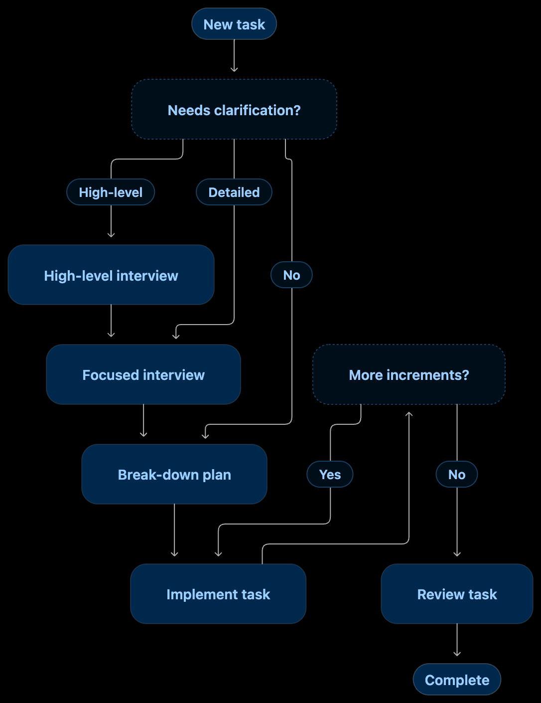

# Human in the Loop: AI Development Workflow

The goal is to delegate development tasks to AI while keeping the human involved in requirements, architecture, implementation decisions and code quality.

## The workflow

The workflow is organized around four main skills:

| Skill | Responsibility |
|---|---|
| Interview me | Establish a shared understanding of requirements. |
| Break-down plan | Turn specifications into small, reviewable implementation tasks. |
| Implement task | Execute approved tasks incrementally using TDD. |
| Review task | Evaluate functional and technical quality. |

## Skills

### Interview me
Two interview approaches help clarify requirements at different levels:

- High-level interview: Define the overall goal, scope and main responsibilities.
- Focused interview: Explore one responsibility in detail and define its acceptance criteria.

### Break-down plan
Inspects the codebase and produces a complete implementation plan divided into atomic, reviewable increments.

### Implement task
Executes the approved plan incrementally, using TDD and human approval gates.

### Review task
Contains two independent review skills:

- Specification review: Verify that the implementation meets the agreed requirements.
- Technical review: Evaluate implementation quality and engineering practices.

## Engineering instructions

Engineering principles are maintained separately from the skills so they can be reused where relevant.

The repository currently includes Java engineering instructions.

## Usage

1. Clone the repository or copy the skills and instructions into your project.
2. Make the skills available to GitHub Copilot in your development environment.
3. Start with `interview-me`, `break-down-plan` or the skill that matches your task.
4. Review and approve the outputs before proceeding.

The interviews and reviews are optional depending on the task.

## Status

Suggestions and feedback are welcome.